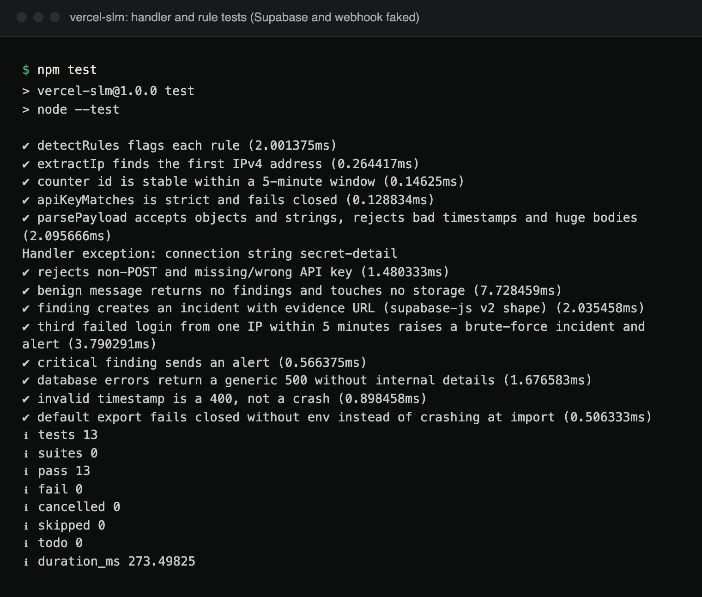
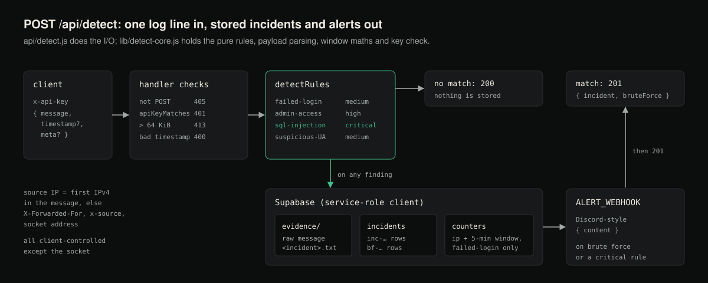

# vercel-slm


A small **security log monitor** built to run as a single Vercel serverless function. Clients POST log lines to
`/api/detect`; the function applies a handful of regex rules (failed logins, `admin` logins, SQL-injection
patterns, scanner user agents), records incidents in Supabase, keeps per-IP failed-login counters to detect
brute force, and can post alerts to a Discord-style webhook.

[Case study ↗](https://hellpuff.dev/work/slm)

**Status:** experimental and not production-ready. There is no tagged release yet (CHANGELOG has only an
Unreleased section, and `package.json` still carries npm's default `1.0.0`). Detection is simple pattern
matching, not a SIEM.

**Requirements:** Node.js 20 or newer (CI tests 20, 22 and 24), a Supabase project, and a Vercel account to deploy.

## Demo



*Terminal capture: `npm test` on the current code. The handler tests run `createHandler` against in-memory fakes for
Supabase and the webhook; the `Handler exception` line is the deliberately failing fake database in the 500 test.*

There is no public deployment right now (the earlier Vercel project was removed), so no live `/api/detect` capture is included. Deploying needs a Supabase project and a Vercel account; see [Deploy](#deploy).

## How a request flows



*Diagram of `api/detect.js` and `lib/detect-core.js`.*

## Example
```bash
curl -s -X POST https://<your-deployment>.vercel.app/api/detect \
  -H 'content-type: application/json' -H "x-api-key: $API_KEY" \
  -d '{"message":"sshd: Failed login for user=admin from 203.0.113.9"}'
```
Response (`201`): `{"ok":true,"incident":{"incident_id":"inc-…","findings":["failed-login","admin-access"],"log_source":"203.0.113.9",…},"bruteForce":false}`.
A message with no findings returns `200 {"ok":true,"findings":[]}` and stores nothing.
(Captured by calling `createHandler` locally with an in-memory fake for Supabase. No live deployment was exercised.)

## API
`POST /api/detect` with header `x-api-key: <API_KEY>` and a JSON body
`{"message": "<log line>", "timestamp": "<ISO 8601, optional>", "meta": {…optional}}` (a plain string body is also accepted).

| Status | Meaning |
|---|---|
| 200 | no rule matched |
| 201 | incident stored; `bruteForce: true` when this was the 3rd+ failed login from the IP in the current 5-minute window |
| 400 | `timestamp` is not a valid date |
| 401 | missing/wrong API key (also when `API_KEY` is not configured) |
| 405 | method other than POST |
| 413 | message larger than 64 KiB |
| 500 | storage/database error, or `SUPABASE_URL`/`SUPABASE_SERVICE_ROLE` not set (details are logged, not returned) |

## Rules
| Rule | Severity | Pattern (case-insensitive) |
|---|---|---|
| failed-login | medium | `failed login`, `authentication failed`, `invalid credentials`, `login failed`, `status=FAILED` |
| admin-access | high | `user=admin`, `username=admin`, `user:admin` |
| sql-injection | critical | `union … select`, `or 1=1`, `inject`, `select *` |
| suspicious-user-agent | medium | `curl`, `sqlmap`, `nikto`, `fuzzer`, `masscan`, `nmap`, `python-requests` |

Brute force: 3 failed-login events from the same IP within one fixed 5-minute window add a `brute-force` incident
and send a webhook alert; every further failure in that window does the same. Critical findings also send an
alert. The source IP is the first IPv4 address in the message, else the first `X-Forwarded-For` entry, else the
`x-source` header, else the socket address. All but the last are client-controlled.

## Deploy
1. Create the tables in Supabase with [docs/schema.sql](docs/schema.sql) (inferred from the code; validated on a local
   PostgreSQL 17, not on a live Supabase project) and a **private** Storage bucket named `evidence`.
2. Import the repo in Vercel and set the variables from [.env.example](.env.example): `SUPABASE_URL`,
   `SUPABASE_SERVICE_ROLE` and `API_KEY` are required; `ALERT_WEBHOOK` and `EVIDENCE_BUCKET` (default `evidence`)
   are optional.
3. Send a test request as in the example above.

## Development
```bash
npm ci
npm test      # node --test; Supabase and the webhook are faked, no network
```
`npm test` runs 13 tests. CI runs `npm ci`, `npm test` and `npm audit --audit-level=high` on Node 20, 22 and 24.
Code layout: `api/detect.js` (handler + Supabase I/O, `createHandler` for dependency injection),
`lib/detect-core.js` (pure rules, parsing, windows, key check), `test/`.

## Limitations
- Regex rules produce false positives/negatives; `inject` or `select *` in benign text will match.
- The brute-force counter is read-modify-write, not atomic: concurrent requests can under-count.
- One shared API key; no per-client keys or rate limiting.
- The evidence "public URL" only works if the bucket is public, which is not recommended.

## Security
See [SECURITY.md](SECURITY.md). Report issues via
[GitHub private advisories](https://github.com/hellpuffyt/vercel-slm/security/advisories/new).

## License
MIT. See [LICENSE](LICENSE).
